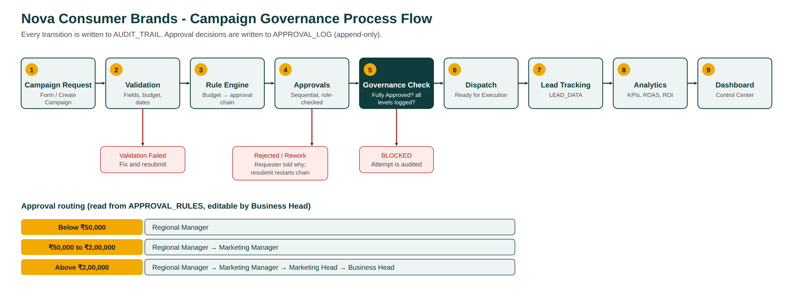

# Automated Marketing Campaign Governance & Regional Execution System

**Company (fictional):** Nova Consumer Brands Pvt. Ltd. · **Regions:** Delhi NCR, Mumbai, Bangalore, Hyderabad, Chennai
**Type:** MBA Finance academic project · all company data is simulated.

A working prototype that takes a marketing campaign from request to dashboard with automatic approval routing, a hard governance gate, lead tracking and KPI analytics. It is built as a local Flask + SQLite application (so it can be demonstrated anywhere in a browser) and mirrored 1:1 by Google Apps Script files for a Google Workspace deployment.

## Run in 3 commands

```bash
pip install -r requirements.txt     # flask, openpyxl
python seed.py                      # builds the sample database
python app.py                       # open http://127.0.0.1:5000
```
All demo users share the password `Demo@123`. The top bar has a "Switch user (demo)" dropdown, so you never have to log out.

## 1. Business Problem
Regional marketing teams raise campaign requests by e-mail and WhatsApp. Finding the right approver, chasing replies and checking that every required sign-off exists is manual. Consequences: slow approvals (hours to days), campaigns started without complete approval (governance and audit risk), no single view of status, and results that never reach finance because lead data lives in scattered sheets.

## 2. Project Objective
Automate request → validation → approval routing → approvals → governance check → dispatch → lead tracking → analytics → dashboard, so that (a) the approval path is decided by budget rules held in a table, (b) a campaign **cannot** be executed without full approval, (c) every action is auditable, and (d) leadership sees live performance (CPL, conversion rate, ROAS, ROI).

## 3. Existing Process (assumed, "Before")
Executive e-mails a request → manager forwards manually → follow-ups on WhatsApp → approvals tracked in a personal sheet → execution team told verbally → leads copied into sheets → monthly report compiled by hand. Assumptions used for the baseline: about 120 minutes of coordination per approval, 14 manual touchpoints, 6 follow-ups, low visibility, and roughly 30% of requests assumed to lack a complete approval record. These are **assumptions, not measurements**.

## 4. Proposed Process ("After")
One form; the system validates, finds the rule, notifies the first approver, advances the chain after each approval, runs the governance check, releases the campaign to the Execution Team, and records leads and performance against the same Campaign ID.

## 5. Process Flow


(Source: `process_flow.svg`.)

## 6. System Architecture
| Layer | Prototype (runs locally) | Google Workspace equivalent |
|---|---|---|
| Intake | Create Campaign page | Google Form / AppSheet |
| Database | SQLite (WAL, foreign keys, triggers) | Google Sheets |
| Business logic | `engine/*.py` | Apps Script `apps_script/*.gs` |
| E-mail | `notifications` outbox (optional SMTP) | Gmail via `MailApp` |
| Files | Creative link field | Google Drive |
| UI / dashboard | Flask API + single-page app, Chart.js | AppSheet + Looker Studio |

```
Browser SPA (static/) ──HTTP/JSON──> app.py (Flask, RBAC, sessions)
                                          └─> engine/ (rules, validation, workflow, governance, tracking, analytics)
                                                  └─> SQLite  (tables + triggers + view + generated columns)
```
Notable design choices: logic lives in `engine/`, not in the web layer; governance is enforced **inside the database** with triggers, so even a buggy screen or a direct SQL update cannot bypass it (Sheets equivalent: protected ranges + `onEdit` guard).

## 7. Database Design
Required tables: `campaign_requests` (CAMPAIGN_REQUESTS), `approval_rules`, `approval_log`, `lead_data`, `campaign_performance`, `users`. Supporting: `audit_trail`, `notifications`, `settings`, `id_counters`.
- `campaign_performance` has **generated columns**: CPL = spend ÷ leads, Conversion_Rate = conversions ÷ leads, ROAS = revenue ÷ spend, ROI = (revenue − spend) ÷ spend (divisions guarded against zero). These mirror spreadsheet formulas.
- View `v_campaign_pipeline` derives the stage Draft → Pending Approval → Approved → Ready for Execution → Executed.
- Triggers: block Ready/Executed unless `Approval_Status='Fully Approved'`; block Fully Approved unless every required level is logged for the current `Revision_No`; freeze details while Pending or Fully Approved; make `approval_log` and `audit_trail` append-only.
- The Google workbook export (`/api/workbook.xlsx`, or `google_sheets/Nova_Marketing_Governance_DB.xlsx`) has the same sheets, dropdown lists and live formulas.

## 8. Business Rules
Stored in `approval_rules`, editable only by the Business Head (the editor rejects gaps, overlaps and invalid roles).

| Budget | Approval chain |
|---|---|
| Below ₹50,000 | Regional Manager |
| ₹50,000 to ₹2,00,000 (both inclusive) | Regional Manager → Marketing Manager |
| Above ₹2,00,000 | Regional Manager → Marketing Manager → Marketing Head → Business Head |

Boundary behaviour is tested: ₹50,000 and ₹2,00,000 both route to two levels; ₹2,00,001 routes to four.
Other rules: approvals must follow the sequence; Regional Managers approve only their own region; nobody approves their own request (segregation of duties); a rejection or send-back needs a reason; resubmission restarts the chain (Revision_No + 1).

## 9. Automation Logic
The twelve named functions exist in both builds (Python in `engine/`, JavaScript in `apps_script/`), each with a business-purpose comment:
`generateCampaignID`, `validateCampaign`, `determineApprovalLevel`, `createApprovalRequest`, `sendApprovalNotification`, `processApproval`, `processRejection`, `processRevision`, `checkGovernance`, `dispatchCampaign`, `updatePerformance`, `calculateKPIs`.
Errors are raised as typed `GovernanceError`s (access denied, out of sequence, locked campaign, duplicate, missing data, rule misconfiguration). Denied attempts are still written to the audit trail.

## 10. User Roles
| Role | Can do |
|---|---|
| Regional Marketing Executive | Create/edit/submit requests for own region, add leads, see own work |
| Regional Manager | Approve/reject/send back own-region requests (step 1) |
| Marketing Manager | Step 2 approver, all regions, campaign and performance view |
| Marketing Head | Step 3 approver, management dashboards |
| Business Head | Step 4 approver, edit approval rules, reset sample data (Executive Demo page) |
| Execution Team | See dispatched campaigns, mark Executed, update delivery numbers |

Three experiences: **Executive** (my requests), **Manager** (my approvals queue), **Management** (portfolio dashboard and governance).

## 11. Governance Controls
1. Fully Approved is required before Ready for Execution (database trigger).
2. Fully Approved is impossible without every required approval logged.
3. Visible Governance Check card (PASS/FAIL per control, stamp: FULLY COMPLIANT or BLOCKED).
4. RBAC and region scoping on every endpoint.
5. Segregation of duties and sequence enforcement.
6. Campaigns are locked while pending or approved.
7. Append-only approval log and audit trail.
8. Duplicate-request detection.

## 12. Dashboard KPIs
Page title: **MARKETING OPERATIONS CONTROL CENTER**. KPI cards: total, active and pending campaigns, total budget, spend, leads, conversions, CPL, conversion rate, ROAS, ROI. Seven charts: campaigns by region, marketing spend by region, lead generation by campaign, conversion funnel, campaign ROI, approval pipeline, campaign performance trend. Filters: region, campaign, type, channel, status, date range, approval status.

## 13. Sample Data
22 seeded campaigns across all five regions and every approval state, 15 users, 3,677 leads, 39 approval-log rows, 153 audit events, 124 notifications. They are produced by running the **real workflow functions** at historical timestamps (not by inserting rows), so the audit trail is genuine. `MKT-2026-001` matches the spec example (250,000 impressions, 12,500 clicks, 850 leads, 420 qualified, 95 conversions, ₹7,20,000 revenue). The Diwali demo is created live during the demo.

## 14. Testing
35 automated test cases (`python tests/run_tests.py`) plus a 32-check browser run (`python tests/ui_smoke.py`, needs Playwright). Result: **35/35 and 32/32 pass.** See `TEST_REPORT.md` for each case's scenario, expected result and the actual captured output.

## 15. Before vs After
| Measure | Before (assumed) | After (measured in prototype) |
|---|---|---|
| Approval coordination time, standard requests | 120 min | 21.4 min average (n = 8, ≤ ₹2,00,000) |
| Leadership-level requests (4 levels) | not separated | 55.2 min average (n = 3) |
| Reduction | | **(120 − 21.4) ÷ 120 = 82.2%** |
| Manual touchpoints per campaign | 14 | 3.4 |
| Follow-ups | 6 | 0 |
| Governance compliance of dispatched campaigns | ~70% assumed | 100% |
| Status visibility | e-mail and WhatsApp | live, one database |

**Honesty note:** "Before" is an assumption for a fictional company. "After" is measured from timestamps in simulated data. If the target were exactly 25 minutes, the reduction would be 79.2%, so the "about 80%" claim holds for an average of 24 minutes or less. 75% of standard requests finished within 25 minutes.

## 16. Business Impact
Faster approvals shorten time-to-market for seasonal campaigns (e.g. Diwali), where a delayed launch loses spend efficiency. Fewer manual touchpoints free regional managers' time. A hard gate removes the risk of unapproved spend, and a complete audit trail supports finance review. Live CPL, ROAS and ROI let leadership shift budget between regions mid-campaign instead of discovering results after month-end.

## 17. Limitations
- Simulated data and an assumed baseline; no real before/after study.
- E-mails are stored in an outbox (SMTP optional); the Apps Script version sends real Gmail.
- Single-server SQLite; no SSO, no file uploads (Drive link only).
- Lead ingestion is manual or simulated, not a live CRM feed.
- The Apps Script files could not be executed inside Google here; their rule and validation logic was unit-tested in Node with a stub, and the full behaviour is proven in the Python build.

## 18. Future Improvements
SSO and delegation of approvals when a manager is on leave; SLA escalation; CRM and ad-platform API ingestion for real spend and leads; budget-versus-actuals alerts for finance; Looker Studio / Power BI connector; approval-time forecasting; multi-currency and multi-company support.

---
### Project files
`app.py`, `seed.py`, `engine/` (logic), `static/` (UI), `tests/`, `docs/`, `google_sheets/` (workbook builder and export), `apps_script/` (Google build).
